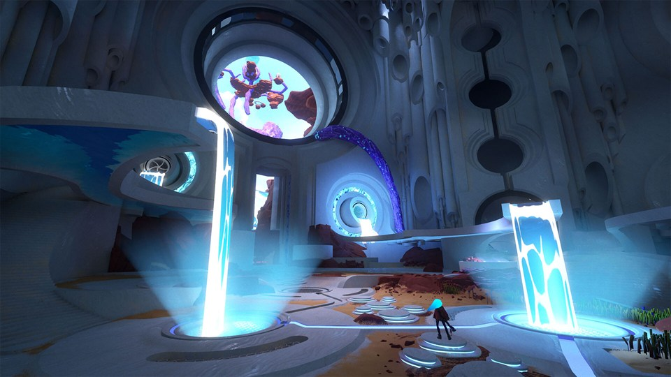
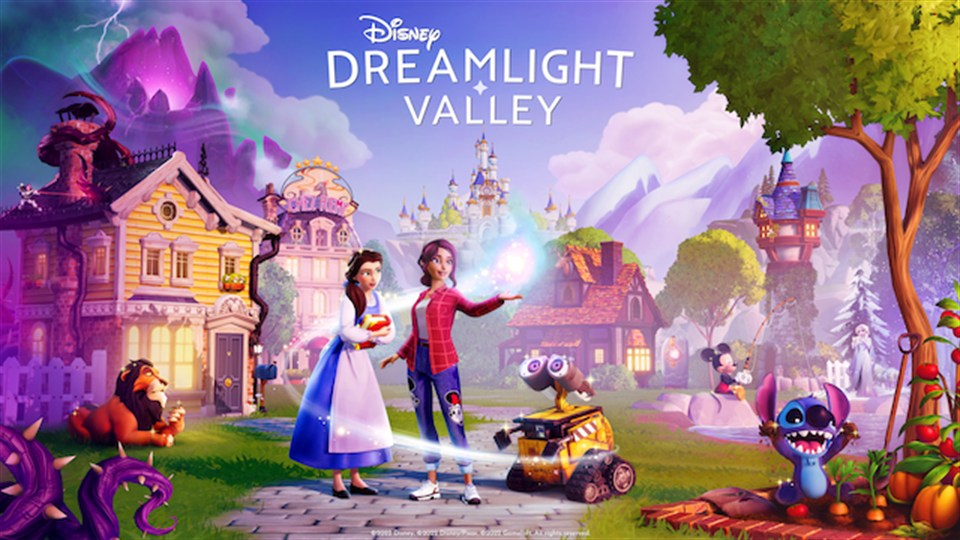
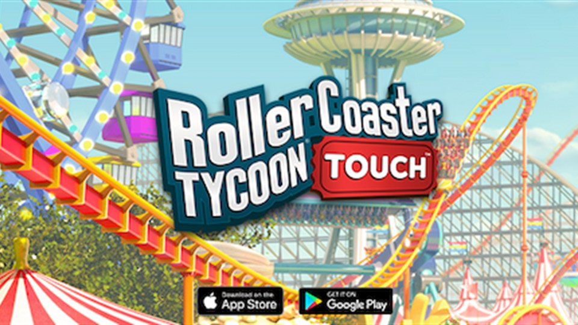
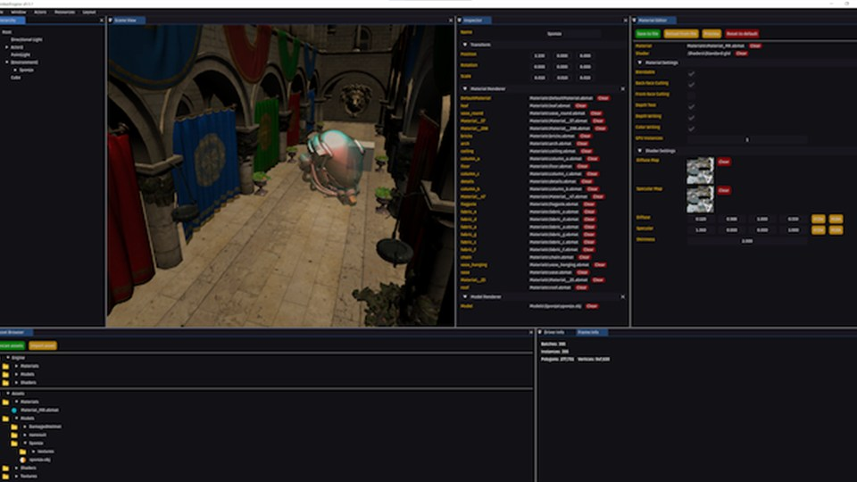
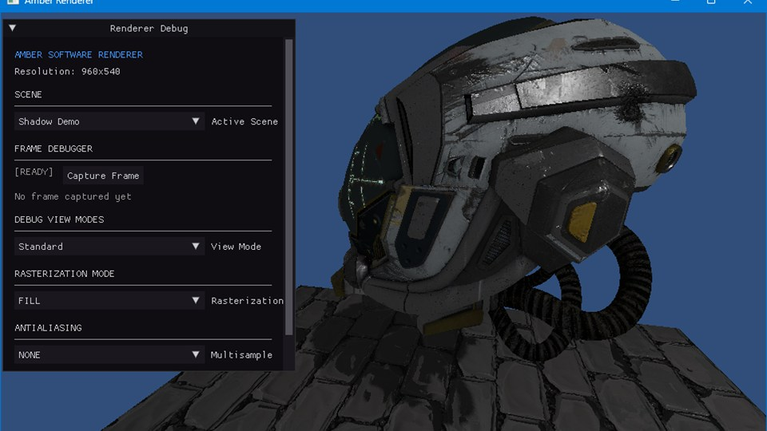

  

  <strong>Software Engineer at <a href="https://newtales.com">New Tales</a></strong> 🌌

### 🎯 **About Me**
- 🌌 **Software Engineer** @ **New Tales** (Unreal Engine 5) - shipped [**Fading Echo**](https://store.steampowered.com/app/2467880/Fading_Echo/) (PC, Xbox Series X|S, PS5, Switch 2)   
Now working on the studio's game-agnostic framework

⚙️ Co-founder of [**Overload Engine**](https://github.com/Overload-Technologies/Overload) an open source 3D Game Engine with Lua scripting

❄️🫕 Alps cold and Canadian cold: I've worked through both 🏔️🍁

### ⚔️ **Professional Experience**

<table>
  <tr>
    <td width="55%">
      
    </td>
    <td width="45%">
      🌌 <b>NEW TALES</b> · 2024 – Now
      <h3><a href="https://store.steampowered.com/app/2467880/Fading_Echo/">Fading Echo</a></h3>
      <b>Software Engineer</b> (Unreal Engine 5) 
      Now working on the studio's game-agnostic framework
        
      
      
    </td>
  </tr>
</table>

<table>
  <tr>
    <td width="50%" valign="top">
      
       
      🏷️ <b>GAMELOFT</b> · 2022 – 2024
      <h3><a href="https://store.steampowered.com/app/1401590/Disney_Dreamlight_Valley/">Disney Dreamlight Valley</a> ✨</h3>
      <b>Former Gameplay / Optimization Support Programmer</b> 
      Research Lab 🧪 &amp; Disney Dreamlight Valley ✨
        
      
      
    </td>
    <td width="50%" valign="top">
      
       
      🏷️ <b>NVIZZIO CREATIONS</b> · 2020 – 2021
      <h3><a href="https://play.google.com/store/apps/details?id=com.atari.mobile.rctempire">RollerCoaster Tycoon® Touch™</a> 🎢</h3>
      <b>Former Gameplay Programmer</b>
        
      
      
    </td>
  </tr>
</table>

### 🏰 **Projects & Contributions**

<table>
  <tr>
    <td width="50%" valign="top">
      
      <h3>⚒️ <a href="https://github.com/maxbrundev/Amberengine">Amber Engine</a></h3>
      open-source 3D Game Engine based on Overload
    </td>
    <td width="50%" valign="top">
      
      <h3>📐 <a href="https://github.com/maxbrundev/Rasterizer">AmberGL</a></h3>
      tile-based multithreaded CPU software renderer with an OpenGL-like API
    </td>
  </tr>
  <tr>
    <td width="50%" valign="top">
      <h3>🌋 <a href="https://github.com/maxbrundev/ObsidianGL">ObsidianGL</a></h3>
      CPU software renderer built around a modern graphics API design
    </td>
    <td width="50%" valign="top">
      <h3>🧰 Amber Framework</h3>
      a data driven game framework built from modular, game-agnostic systems (Abilities, Action Phase, Entities, UI, etc.)
    </td>
  </tr>
</table>

**🚀 Take a look at my Portfolio on my [website](https://maxbrundev.com)! 🚀**

